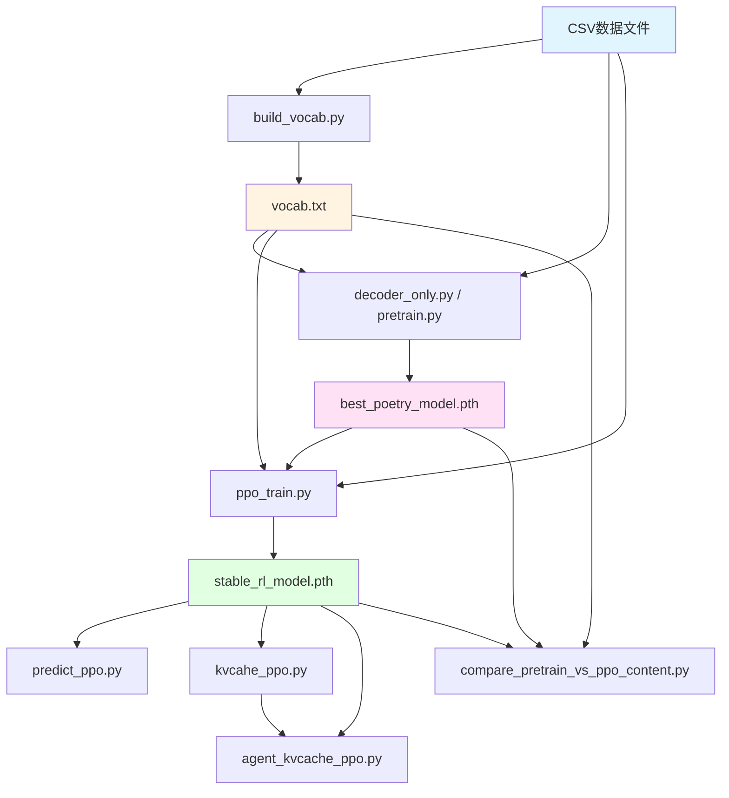
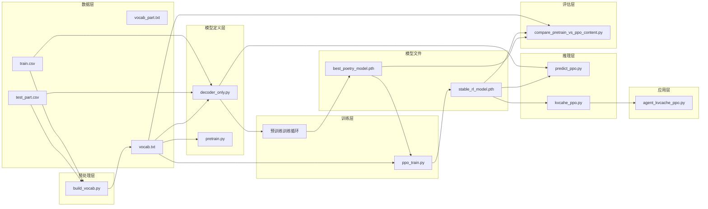
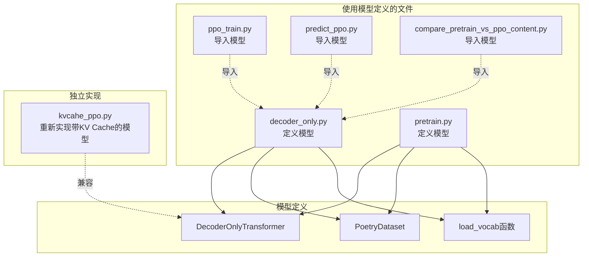
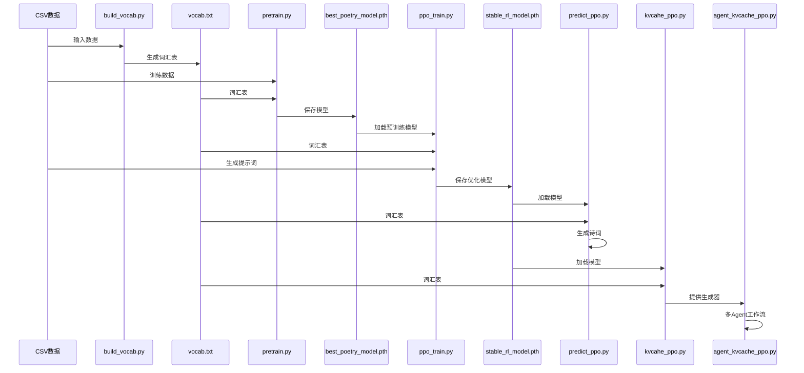
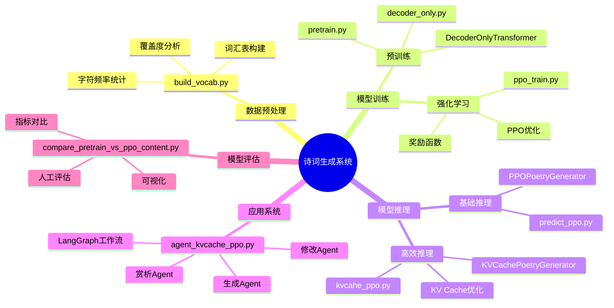
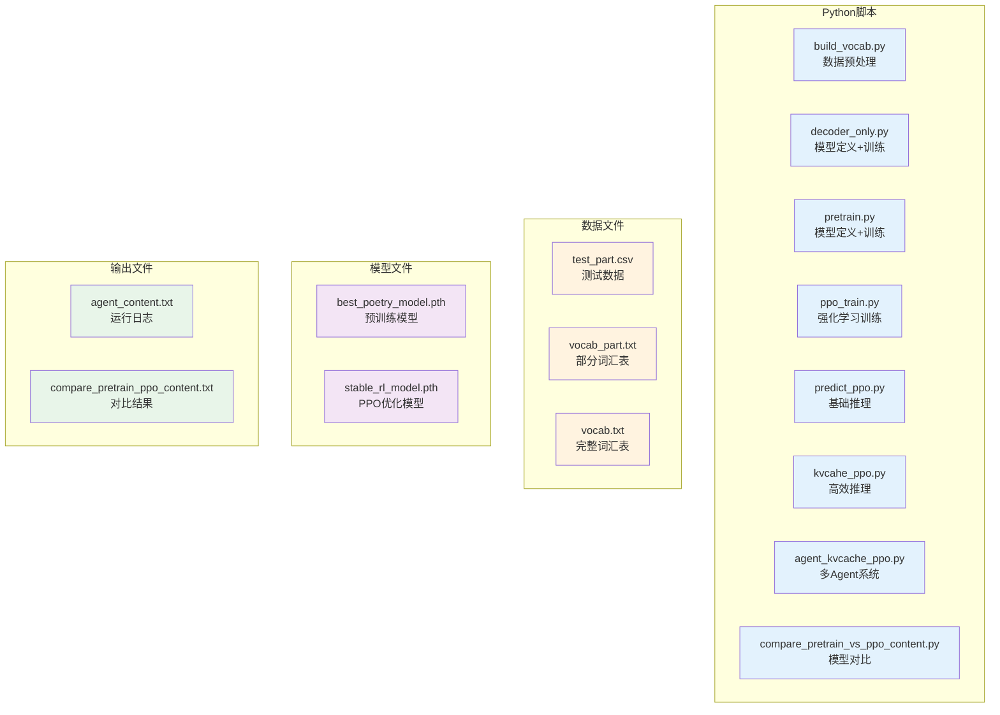
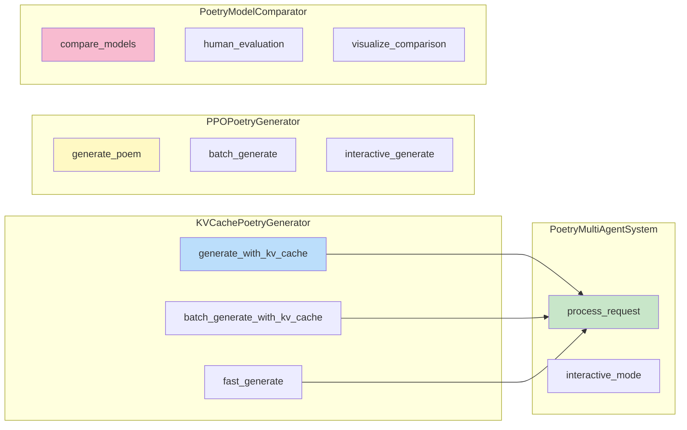
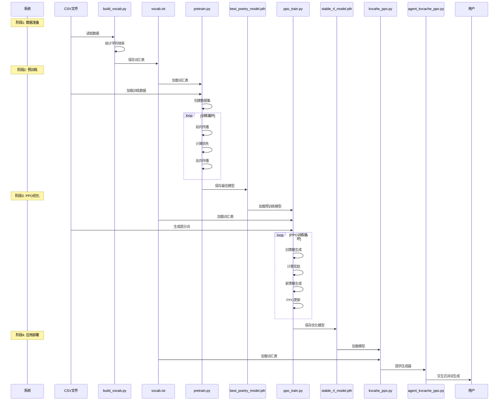

# 文件关系可视化图

## 一、整体架构流程图

## 二、详细依赖关系图

## 三、代码复用关系图

## 四、数据流向图

## 五、功能模块关系图

## 六、文件类型分类

## 七、关键接口关系

## 八、训练流程时序图

## 九、总结

以上图表展示了整个诗词生成系统的文件关系，包括：
- 数据流向
- 代码依赖
- 功能模块
- 训练流程
- 应用部署

整个系统设计清晰，遵循标准的深度学习工作流。
